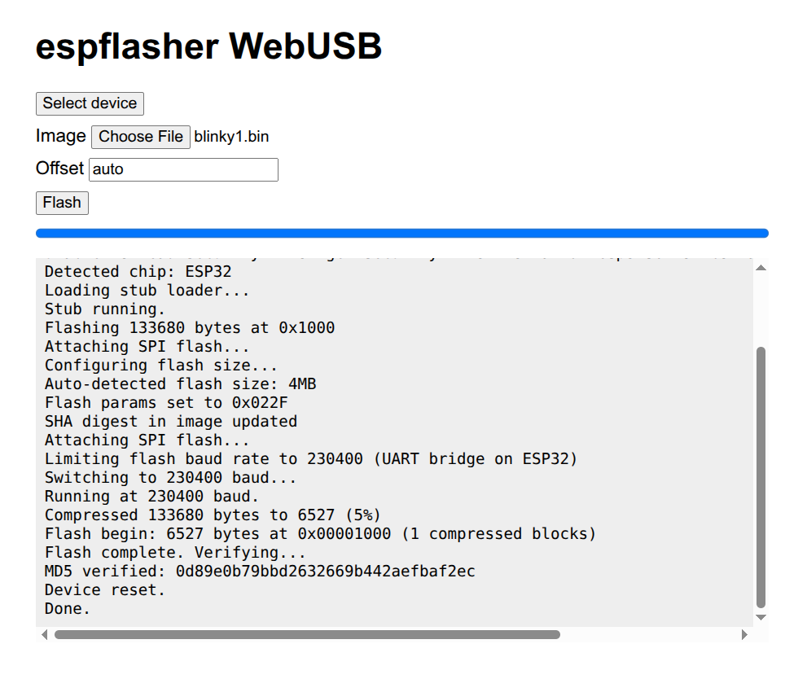

# WebUSB example



Flash an ESP board from the browser using espflasher compiled to wasm.

## Build

With Go:

```sh
GOOS=js GOARCH=wasm go build -o main.wasm .
cp "$(go env GOROOT)/lib/wasm/wasm_exec.js" .
```

With TinyGo:

```sh
tinygo build -target=wasm -o main.wasm .
cp "$(tinygo env TINYGOROOT)/targets/wasm_exec.js" .
```

The `wasm_exec.js` file must come from the same toolchain that built `main.wasm`.

## Run

```sh
go run .
```

Open http://localhost:8080 in Chrome or Edge. Click "Select device", choose a `.bin` file and click "Flash". The offset defaults to `auto`, which uses the chip's bootloader offset (`0x1000` on ESP32 and ESP32-S2, `0x2000` on ESP32-C5 and ESP32-P4, `0x0` on the others). That is where a TinyGo `.bin` goes.

## Platform notes

WebUSB only works in Chromium based browsers, on localhost or HTTPS.

The browser must be able to claim the USB interface, so the OS serial driver can't be holding it.

### Linux

Give your user access to the USB device. Without this, Chrome reports `Access denied` when opening it.

```sh
sudo tee /etc/udev/rules.d/60-espflasher-webusb.rules <<'EOF'
SUBSYSTEM=="usb", ATTRS{idVendor}=="303a", MODE="0660", GROUP="plugdev", TAG+="uaccess"
SUBSYSTEM=="usb", ATTRS{idVendor}=="10c4", ATTRS{idProduct}=="ea6[0-9]|ea7[01]", MODE="0660", GROUP="plugdev", TAG+="uaccess"
SUBSYSTEM=="usb", ATTRS{idVendor}=="1a86", MODE="0660", GROUP="plugdev", TAG+="uaccess"
EOF
```

Stop the kernel serial driver from holding the device. Without this, Chrome reports `Unable to claim interface`. A one time unbind is not enough since the board re-enumerates when it resets into the bootloader.

```sh
sudo tee /etc/udev/rules.d/61-espflasher-webusb-unbind.rules <<'EOF'
ACTION=="bind", SUBSYSTEM=="usb", DRIVER=="cdc_acm", ATTRS{idVendor}=="303a", ATTRS{idProduct}=="1001", RUN+="/bin/sh -c 'echo -n %k > /sys/bus/usb/drivers/cdc_acm/unbind'"
ACTION=="bind", SUBSYSTEM=="usb", DRIVER=="cp210x", RUN+="/bin/sh -c 'echo -n %k > /sys/bus/usb/drivers/cp210x/unbind'"
ACTION=="bind", SUBSYSTEM=="usb", DRIVER=="ch341", RUN+="/bin/sh -c 'echo -n %k > /sys/bus/usb/drivers/ch341/unbind'"
EOF
```

Reload the rules, then unplug and replug the board.

```sh
sudo udevadm control --reload-rules && sudo udevadm trigger
```

While the unbind rule is installed, these devices get no `/dev/ttyACM*` or `/dev/ttyUSB*`, so `tinygo flash`, the espflasher CLI and serial monitors can't use them.

#### Switching between WebUSB and serial

`webusb-mode.sh` turns the unbind rule on or off by renaming it, since udev only reads files ending in `.rules`. Replug the board after switching.

```sh
./webusb-mode.sh on      # use WebUSB
./webusb-mode.sh off     # use /dev/ttyUSB* or /dev/ttyACM*
./webusb-mode.sh status
```

Keep `60-espflasher-webusb.rules` installed. It doesn't affect normal serial use.

CP210x and CH34x boards don't re-enumerate when the chip resets, so they can also be switched without the rule or a replug by unbinding or rebinding the driver. `1-9` is the USB port path, see `ls /sys/bus/usb/drivers/cp210x`.

```sh
echo -n 1-9:1.0 | sudo tee /sys/bus/usb/drivers/cp210x/unbind   # use WebUSB
echo -n 1-9:1.0 | sudo tee /sys/bus/usb/drivers/cp210x/bind     # back to /dev/ttyUSB0
```

Native USB boards need the rule for WebUSB, because they re-enumerate when reset into the bootloader and the kernel driver would bind again.

### Windows

Install the WinUSB driver for the device, for example with Zadig.

### macOS

The device must not be claimed by a system or vendor serial driver.

### Re-enumeration

Native USB boards re-enumerate when they reset into the bootloader. If the bootloader shows up with a different VID/PID than the app, for example after a USB-OTG 1200 baud touch, pick that device too so the page has permission to reopen it.
